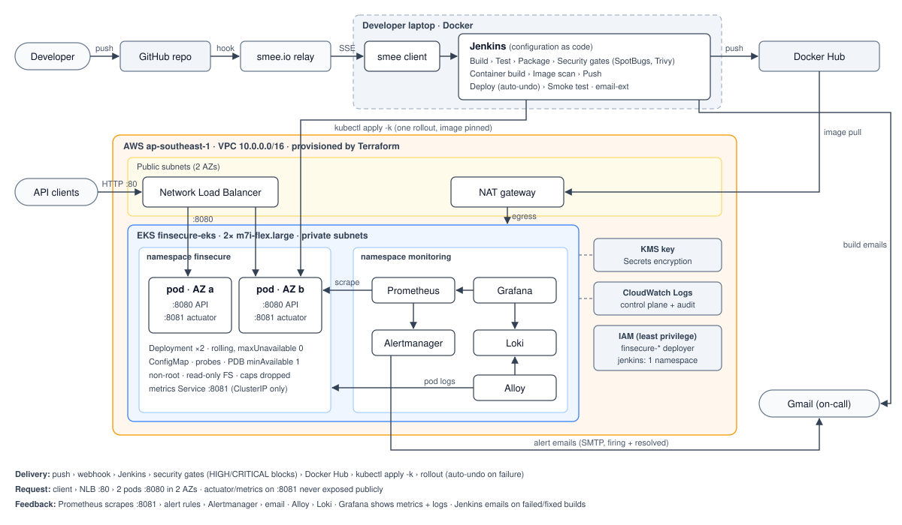

# FinSecure Pay – Transaction Validator: Design Document

**Project:** NUS DevOps Capstone · **Author:** Jordan Ong · **Date:** 2026-11-03 · **Repo:** github.com/jordyong/nus-devops-capstone

## 1. Summary

FinSecure Pay needed a fast, repeatable and safe way to ship its transaction validation API. The solution takes a Spring Boot service from a `git push` to a production-style deployment on Amazon EKS with no manual steps. The pipeline builds, tests and security-scans every change, any HIGH or CRITICAL finding stops the release, and only then is the change deployed. A failed rollout is undone automatically. Prometheus, Grafana and Loki watch the running service, and email alerts reach a human within about two minutes of a problem. The whole environment (network, cluster, app, monitoring) is rebuilt from code in about 20 minutes and destroyed after each working session to control cost.

| Area | Implemented with | Evidence |
| ---- | ---------------- | -------- |
| Application | Spring Boot 4.0.9 / Java 21, `POST /validate` (7 rules), `GET /health`; 28 JUnit 5 tests | [task-1](task-1-application.md) |
| Container | Multi-stage Dockerfile, layered JRE-Alpine image, non-root, Docker Hub | [task-2](task-2-containerisation.md) |
| Platform | Terraform → VPC + EKS 1.37 (2 nodes, 2 AZs), Deployment ×2, NLB, ConfigMap, probes, PDB | [task-3](task-3-kubernetes.md) |
| CI/CD | Jenkins (configuration as code), push-triggered pipeline, auto-undo, `ROLLBACK_TAG` | [task-4](task-4-cicd.md) |
| DevSecOps | SpotBugs + FindSecBugs, Trivy (dependencies, secrets, IaC, image), HIGH/CRITICAL gate | [task-5](task-5-security.md) |
| Observability | kube-prometheus-stack, business metrics, 4 alert rules, Alertmanager + Jenkins email, Loki | [task-6](task-6-monitoring.md) |

## 2. End-to-end architecture

## 3. Major tool choices

| Need | Choice | Why this over the alternatives |
| ---- | ------ | ------------------------------ |
| Infrastructure | **Terraform** + community `vpc`/`eks` modules | Declarative and repeatable (the cluster is rebuilt every session); the modules encode AWS best practice (private nodes, KMS, access entries). |
| Kubernetes | **Amazon EKS**, managed node group | Managed control plane, IAM authentication, CloudWatch control-plane logs. |
| Manifests | **Plain YAML + kustomize** | Six small objects don't need Helm; kustomize (built into kubectl) pins the image tag at deploy time. |
| CI/CD | **Jenkins** (JCasC + Job DSL) in Docker | Plugins, job, credentials and email are all code: `docker compose up` gives an identical server every time. |
| Registry | **Docker Hub** | Recommended by the brief; pushes use a scoped access token. |
| SAST | **SpotBugs + FindSecBugs** | Runs inside Maven with no server or account and fails the build; it caught real issues in Tasks 5 and 6. |
| SCA, image, IaC, secrets | **Trivy** | One tool and DB for the jar, image, Terraform/K8s/Dockerfile and secrets; unlike OWASP Dependency-Check, no NVD key or hours-long first sync. |
| Metrics, alerts | **kube-prometheus-stack** | Prometheus, Alertmanager, Grafana and exporters in one chart; `ServiceMonitor`/`PrometheusRule` keep scrape config and alerts in the repo. |
| Logs | **Loki + Grafana Alloy** | Logs next to metrics in Grafana, far lighter than EFK, no extra AWS IAM needed. |
| Notifications | **Alertmanager + Jenkins email-ext** via Gmail SMTP | Real emails to a real mailbox; the app password stays outside the repo. |

## 4. Key design decisions

1. **Immutable, traceable releases.** Every build is tagged `<pom version>-<git short sha>` and deployed by that tag. `kubernetes.io/change-cause` records `Jenkins #N: <image>` on each revision, so `kubectl rollout history` reads as a release log.
2. **Report every error, and count it.** The validator evaluates all seven rules and returns every violation (422). `finsecure_validation_errors_total{code}` then turns "lots of 422s" into a diagnosis: "currency rule failing" (a config change) versus "every rule failing" (one bad client).
3. **Configuration outside the image.** Limits such as `VALIDATION_MAX_AMOUNT` come from a ConfigMap, so one image runs in every environment.
4. **The pipeline is the only path to production.** Jenkins applies all manifests together with the image in one rollout, so probe, port or config changes ship with the code that needs them (Task 6 moved actuator to port 8081).
5. **Session-scoped infrastructure.** The cluster (about US$0.40/h) is destroyed after each session and rebuilt from Terraform + `kubectl apply -k` + `monitoring/install.sh`, which kept cost down and proved the environment is reproducible from the repo.

## 5. Security considerations

- **Shift-left gates.** Every build runs SAST, a dependency scan of the shipped jar, a secret + IaC scan of the repo, and an image scan before push. Any HIGH or CRITICAL finding fails the build, and Push/Deploy are skipped. On introduction, the gate blocked the existing code for real reasons: 11 HIGH/CRITICAL CVEs in Tomcat, Spring and Jackson, plus an open `0.0.0.0/0` API CIDR default. Remediation meant upgrading to Spring Boot 4 and fixing Terraform. A controlled Text4Shell dependency was also blocked on demand.
- **Explicit, expiring risk acceptance.** Two IaC findings (a public EKS endpoint restricted to one /32, and node egress through NAT) are accepted in `.trivyignore.yaml` with a justification and an expiry date. After that date they block the pipeline again.
- **Secrets never in source.** Docker Hub, AWS, SMTP and Grafana credentials live in a workspace folder outside the repo. They reach Jenkins as Docker secrets → JCasC credentials (masked as `****` in logs), and reach the cluster as Kubernetes Secrets encrypted with a KMS key. gitleaks found no leaks in the full git history. Registry and kube credentials are scoped per build and deleted afterwards.
- **Least privilege.** The Terraform user is limited to `finsecure-*` resources in one region. The Jenkins IAM user can only describe the cluster, and its EKS access entry grants edit rights in the `finsecure` namespace only.
- **Hardened runtime.** Non-root uid 10001, read-only root filesystem, all capabilities dropped, no privilege escalation, seccomp `RuntimeDefault`, a minimal JRE-Alpine base patched at build time. Nodes sit in private subnets, actuator is not exposed publicly, and Grafana/Prometheus are reachable only through an authenticated `kubectl port-forward`.
- **No customer data in logs.** Decisions are logged with the transaction ID and rule codes only, never account numbers or amounts.

## 6. Reliability and recovery considerations

| Failure | Detection | Recovery | Shown in |
| ------- | --------- | -------- | -------- |
| Pod crash / hang | liveness probe on `/actuator/health/liveness` | kubelet restarts the container; a deleted pod is recreated by the ReplicaSet within seconds | Task 3 §7.3 |
| Pod not ready (startup, dependency) | readiness probe | removed from the Service endpoints, no traffic until Ready | Task 3 |
| Node or AZ loss | 2 replicas spread over nodes/AZs (topology spread) | the second replica keeps serving; the PDB (`minAvailable: 1`) blocks voluntary evictions of both | Task 3 |
| Bad release that never becomes healthy | `kubectl rollout status --timeout=180s` in Deploy | pipeline runs `kubectl rollout undo` automatically; `maxUnavailable: 0` keeps old pods serving throughout | Task 4, Task 6 build #17 |
| Bad release that is healthy but wrong | alerts, smoke test, humans | `ROLLBACK_TAG=<known-good tag>` re-deploys an exact earlier image, or `kubectl rollout undo` (10 revisions kept) | Task 4 builds #4, #5 |
| Vulnerable dependency / image | security gates | release blocked before push, so production stays on the last good version | Task 5 builds #8, #9, #11 |
| Degraded service (rejection spike, latency, replicas down) | 4 Prometheus alert rules | email to on-call within ~2 min; dashboard and Loki for diagnosis | Task 6 §6 |
| Loss of the whole environment | n/a | `terraform apply` → `kubectl apply -k k8s/` → `monitoring/install.sh` (~20 min); the app is stateless | every session |

**Known gaps:** local Terraform state (single point of failure), single NAT gateway, ephemeral Prometheus/Loki storage, and Jenkins running on a laptop. §9 covers how to fix them.

## 7. AI use case: an AI incident triage assistant

### 7.1 Problem, and why AI

When an alert fires, an engineer spends the first 10–20 minutes collecting context before any decision: which metric moved, which pods, what the logs say, whether something was just deployed, whether a security scan changed. In this project's own alert demo, the useful conclusion was "every rule is failing equally, the transaction IDs share one prefix, both pods are affected and nothing was deployed, so a client is sending bad requests, not a regression; don't roll back". Reaching it meant reading four tools. The task is repetitive, time-critical and done under stress, which is where on-call mistakes happen.

Fixed rules can't do this well, because the evidence is mixed: numeric time series, free-text logs, deploy history and runbooks. A large language model (LLM) with read-only tool access is a good fit. It can query the same sources an engineer would, correlate them, and write a short, cited explanation in plain language. The assistant **does not act**. It summarises and recommends, and a human decides. That keeps the risk low while saving the most expensive minutes of an incident.

### 7.2 Inputs

| Input | Source in this solution |
| ----- | ----------------------- |
| The alert: name, labels, annotations, start time | Alertmanager webhook payload |
| Metrics around the alert window (rate, rejection mix by `code`, latency, replicas, CPU/memory) | Prometheus HTTP API, a fixed set of PromQL queries per alert |
| Recent application logs (errors, REJECTED lines, by pod) | Loki HTTP API, LogQL with a time window and line limit |
| What changed: last rollouts and their change-cause, current image tag | `kubectl rollout history` / Deployment annotations (read-only RBAC) |
| Pipeline context: last builds, failed stage, Trivy/SpotBugs summary | Jenkins JSON API and archived reports |
| Runbooks and alert descriptions | `monitoring/app-monitoring.yaml` annotations and `docs/` (retrieved as text) |
| Prompt | A fixed system prompt: role ("SRE triage assistant for FinSecure Pay"), allowed tools, required output format (summary, evidence with query links, likely cause with confidence, recommended next step from the runbook, what *not* to do), and an instruction to say "unknown" rather than guess |

### 7.3 Expected benefits

- **Lower time to diagnosis.** The first summary arrives with the alert email (target: under 1 minute after firing) instead of after 10–20 minutes of manual querying.
- **Fewer wrong reactions.** For example, it can say *don't* roll back when the cause is client traffic, or *do* roll back when the spike starts at a `Jenkins #N` change-cause.
- **Consistency and knowledge sharing.** Every incident gets the same checklist, and junior on-call engineers get the reasoning, not just the alert.
- **A better record.** Each summary, with its evidence, is stored as the start of the post-incident review.

### 7.4 Limitations, risks and governance

| Risk | Mitigation |
| ---- | ---------- |
| **Hallucination / wrong cause** | Advisory only; every claim must cite its query and result; show confidence; measure precision on past incidents first. |
| **Prompt injection via logs** (e.g. a crafted transaction ID) | Logs are delimited data, never instructions; no write tools; excerpts capped and sanitised; output never triggers an action. |
| **Data protection** (regulated fintech data) | Logs already exclude account numbers and amounts; redact again before data leaves the cluster; provider/region/contract meeting data-residency and no-training rules; audit log of every prompt and response. |
| **Over-reliance** | A human takes every action (rollback stays a person-run `ROLLBACK_TAG` build); summaries are reviewed in post-incident reviews. |
| **Cost / availability** | Runs only on grouped firing alerts, with timeouts and token limits; if the LLM is down, the normal alert email is unaffected. |
| **Least privilege** | Dedicated ServiceAccount with `get/list` in `finsecure` only; cluster-internal Prometheus/Loki URLs; API key in a KMS-encrypted Secret. |

### 7.5 Integration with the existing solution

1. **Trigger:** add a second Alertmanager receiver (`webhook_configs` → `http://triage-assistant.monitoring.svc/alert`) next to the unchanged email receiver, routed for `team="finsecure"`.
2. **Service:** `triage-assistant`, a small stateless ClusterIP service in this repo, built, scanned and deployed by the same Jenkins pipeline with the same hardening.
3. **Tools for the LLM:** `query_prometheus`, `query_loki`, `get_rollout_history`, `get_recent_builds`, all read-only, time-bounded and size-capped. A short tool-use loop produces the summary, which is emailed in the alert's thread.
4. **Operations:** monitored like the app (metrics, alerts); each summary is stored as the start of the post-incident review.

Worked example on this project's Task 6 demo. Expected output: *"HighTransactionRejectionRate: 100% of ~3.5 tx/s rejected since 17:21. All rejections break the same three rules (AMOUNT_LIMIT_EXCEEDED, UNSUPPORTED_CURRENCY, SAME_ACCOUNT) at equal rates; both pods are affected equally; the IDs share the prefix DEMO-; no rollout happened in the alert window. Likely cause: one client sending invalid requests, not a release regression (confidence: high). Recommended: identify the client and contact its owner; do **not** roll back."*

Start in **shadow mode** (summaries logged, not sent) for a few weeks and compare them with what on-call actually found.

## 8. Lessons learned

- **Real findings beat planted ones.** The gate's first run blocked the existing code on 11 genuine CVEs and a real IaC weakness; the fix was a framework major upgrade (Spring Boot 3.5 → 4). The SAST gate later caught my own Task 6 code.
- **Deploying only the image is not enough.** `kubectl set image` silently skips manifest changes; moving actuator to a new port would have failed every probe.
- **Never interrupt `terraform apply`.** An interrupted apply left a cluster that existed in AWS but not in state, and import couldn't recover it. Remote state with locking is the real fix.
- **Account limits fail silently.** The Free plan rejected `t3.medium`; the node group just sat in CREATING until the Auto Scaling activity log showed why.
- **Pin and verify tools.** smee-client v5 broke webhooks (405), Trivy got rate-limited by Maven Central scanning `pom.xml`, Loki needed a writable volume without persistence. Pinned versions made each reproducible and fixable.
- **Business metrics make alerts actionable.** The rejection-by-reason counter is what turned an alert into a diagnosis.

## 9. Future improvements

| Priority | Improvement |
| -------- | ----------- |
| High | **Remote Terraform state** (S3 + DynamoDB lock); **ECR + EKS Pod Identity** and **External Secrets** (AWS Secrets Manager) instead of long-lived tokens and IAM user keys |
| High | **Ephemeral build agents** (Kaniko/BuildKit pods) instead of a laptop Jenkins with the Docker socket, or GitOps with **Argo CD** |
| Medium | **Canary releases** (Argo Rollouts) auto-rolled-back on the same Prometheus metrics; **signed images + SBOM** (cosign) enforced by an admission policy (Kyverno) |
| Medium | **Persistent observability** (EBS CSI or Amazon Managed Prometheus/Grafana, Loki on S3, SLO alerts); **network hardening** (private API endpoint, VPC endpoints, NetworkPolicies, TLS on the NLB) |
| Low | HorizontalPodAutoscaler; NAT gateway per AZ; SonarQube trends; the AI triage assistant (§7) in shadow mode |
